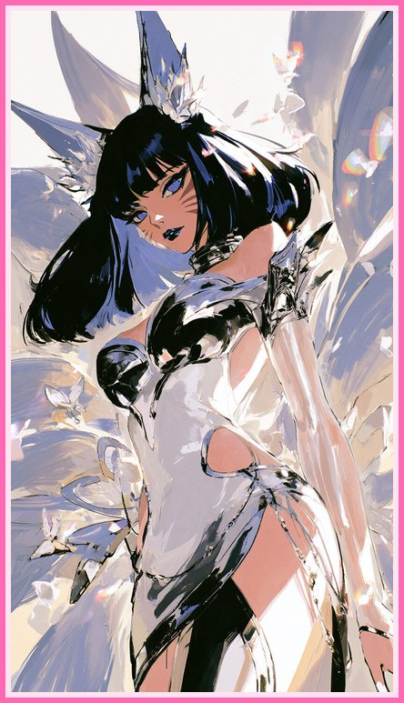
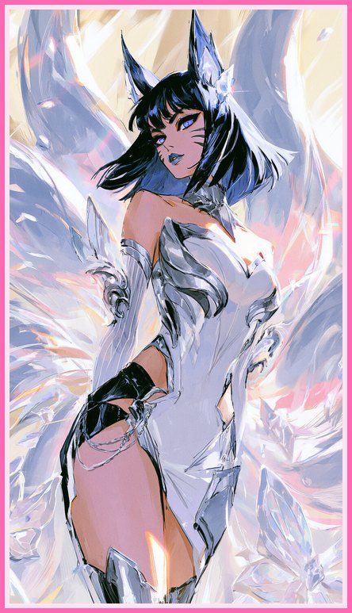
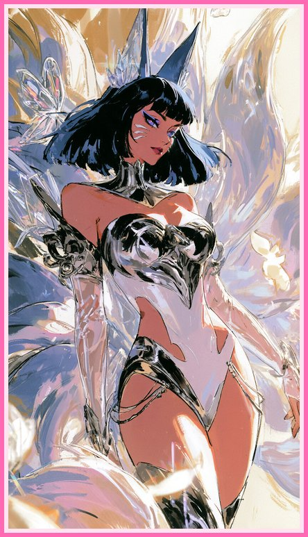

<table width="100%">
<tr>
<td align="center">

 

</td>
</tr>
</table>

<table width="100%">
<tr>
<td colspan="2">

</td>
</tr>
<tr>
<td width="62%" valign="top">
<b>Programadora, designer e nutricionista</b> (22 anos)
  
Sou técnica em gastronomia, de peixes e apaixonada por estudar: já fiz mais de 80 cursos.
  
Adoro jogos, adoro videogame, em especial LOL.
  
Hoje, programar é o que eu mais gosto de fazer. Também amo gatos, crochê e o Halloween.
</td>
<td align="center" valign="middle">

</td>
</tr>
</table>

 

 

 

  

 

